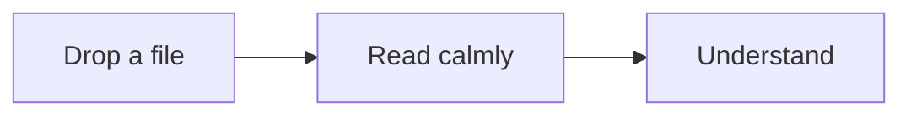

# Welcome to MarkV

A quiet place to read markdown. Open a file, settle in, and take it in at your own pace.

## Open something of yours

Drop a `.md` file anywhere on this page, or use **Files** at the top left. Open a whole folder and every note in it is a click away.

## Make it yours

Change the text size, line spacing, width and palette with **Aa**. On a phone, open **More → Aa**; on desktop, choose **Aa** at the bottom. MarkV remembers your choices, so every document opens the way you like it.

## Find your way

Longer documents get an outline on the right that follows along as you read. Press <kbd>⌘K</kbd> to search your files and run any command.

When you want to write, switch to **Edit**. Coming back to **Read** returns you to the same spot.

## See the shape of things

Diagrams, tables, maths and code all render the way you would expect.

This diagram is three lines of plain text in the file. MarkV draws it.

## Ask, if you want to

AI is entirely optional. Connect your own Groq or OpenRouter key, or use Ollama on your computer, to ask questions about a document or map its ideas. Your key is stored only in this browser. Using hosted AI sends relevant document excerpts to your chosen provider; Ollama processes them on your computer.

## Ready when you are

Your first file is one drop away.
